<p align="center">
  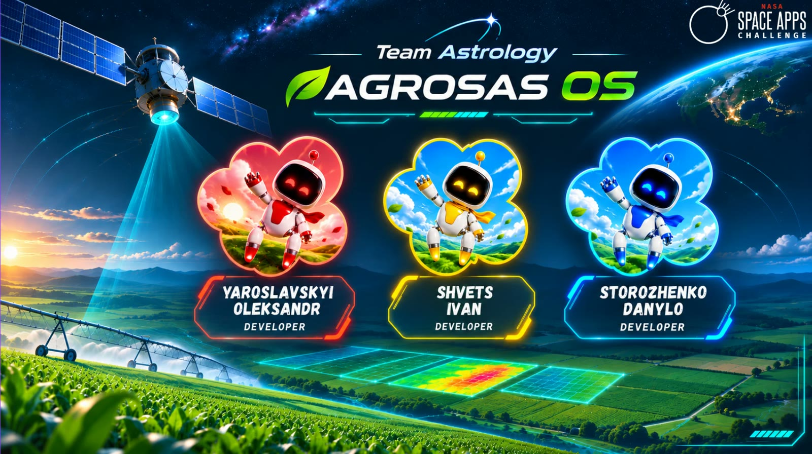
</p>

<h1 align="center">AGROSAS OS</h1>

<p align="center">
  <b>From space to soil. From data to decisions.</b><br>
  A farm operating system that turns open NASA Earth data into concrete decisions for one real field.
</p>

<p align="center">
  
  
  
  
</p>

<p align="center">
  <a href="#-watch-it"><b>Watch</b></a> ·
  <a href="#the-problem"><b>Problem</b></a> ·
  <a href="#what-it-does"><b>Features</b></a> ·
  <a href="#open-data-honestly-used"><b>Data</b></a> ·
  <a href="#architecture"><b>Architecture</b></a> ·
  <a href="#quick-start"><b>Quick start</b></a> ·
  <a href="#team-astrology"><b>Team</b></a>
</p>

<table align="center">
  <tr>
    <td align="center"><h2>12</h2>science satellites<br>tracked live</td>
    <td align="center"><h2>7 565</h2>Starlink craft<br>in the catalog</td>
    <td align="center"><h2>30 yrs</h2>of climate<br>behind every field</td>
    <td align="center"><h2>7</h2>climate scenarios<br>up to 2050</td>
    <td align="center"><h2>112</h2>automated<br>tests</td>
  </tr>
</table>

---

## ▶ Watch it

<p align="center">
  <a href="https://github.com/Storozh-007/AGROSAS-FieldShift/releases/download/v1.0/AGROSAS-OS-teaser-en.mp4">
    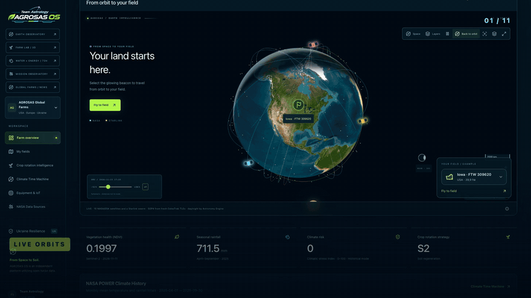
  </a>
</p>

| | English | Ukrainian |
|---|---|---|
| **35-second teaser** (60 fps) | [▶ Watch](https://github.com/Storozh-007/AGROSAS-FieldShift/releases/download/v1.0/AGROSAS-OS-teaser-en.mp4) | [▶ Watch](https://github.com/Storozh-007/AGROSAS-FieldShift/releases/download/v1.0/AGROSAS-OS-teaser-uk.mp4) |
| **Full narrated tour** (~4 min) | [▶ Watch](https://github.com/Storozh-007/AGROSAS-FieldShift/releases/download/v1.0/AGROSAS-OS-demo-en.mp4) | [▶ Watch](https://github.com/Storozh-007/AGROSAS-FieldShift/releases/download/v1.0/AGROSAS-OS-demo-uk.mp4) |

All videos are attached to the [v1.0 release](https://github.com/Storozh-007/AGROSAS-FieldShift/releases/tag/v1.0).

---

## The problem

The climate under every field is shifting. The data to see it — decades of reanalysis, daily satellite imagery, soil and terrain maps — is free and open. But it speaks in grids, granules and file formats, not in *“what do I sow next spring?”* or *“can I spray on Tuesday?”*

**AGROSAS OS is the bridge.** Point at a field, and the platform builds its passport from open data, simulates the future, and ends every insight in a task a farmer can close with one click.

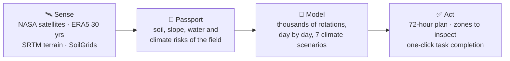

---

## What it does

<table>
  <tr>
    <td width="50%" valign="top">
      <h3>🌍 Live globe & real orbits</h3>
      Real satellites on their current orbits, propagated every second with SGP4 from fresh orbital elements — Terra, Landsat, SMAP, the ISS and the Starlink swarm. Day and night follow the real Sun. One click opens the Solar System with today’s planet positions and JPL comet orbits.
    </td>
    <td width="50%">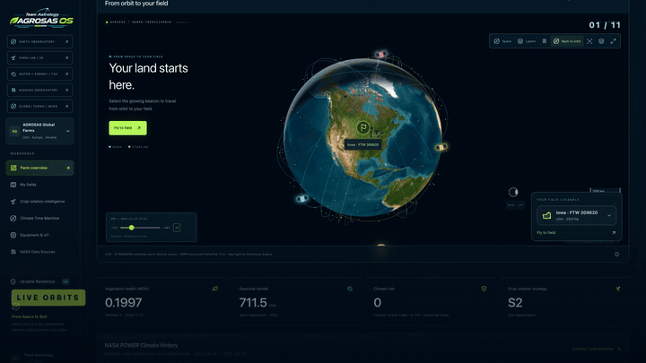</td>
  </tr>
  <tr>
    <td width="50%">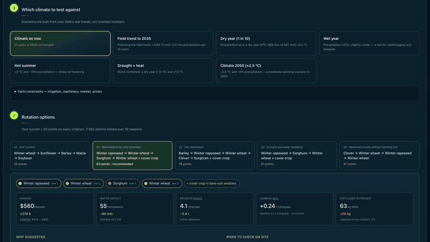</td>
    <td width="50%" valign="top">
      <h3>🧮 Crop rotation model</h3>
      For every field the platform simulates thousands of rotations day by day against the field’s own 30-year climate. Pick a goal — stable income, maximum profit, surviving drought or restoring soil — and stress-test it: <i>now, trend to 2035, dry year, wet year, hot summer, drought + heat, climate 2050</i>. Every recommendation shows margin, water deficit, erosion and <b>why</b>.
    </td>
  </tr>
  <tr>
    <td width="50%" valign="top">
      <h3>🗺️ 3D field zones</h3>
      A 20 m grid on real SRTM terrain combined with Sentinel-2 NDVI: where water collects, where the slope erodes the soil, where the field is strongest — plus a soil-sampling route and per-zone seeding and nitrogen hints.
    </td>
    <td width="50%">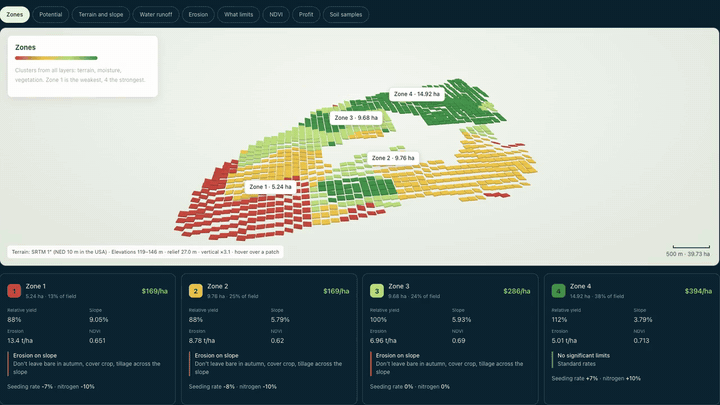</td>
  </tr>
  <tr>
    <td width="50%">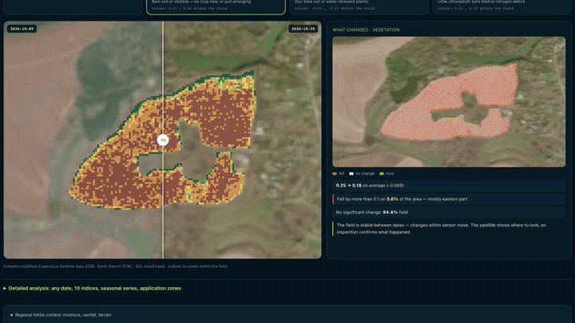</td>
    <td width="50%" valign="top">
      <h3>🛰️ Field from space</h3>
      Cloud-free Sentinel-2 dates are picked automatically. Vegetation, leaf water and chlorophyll are compared before and after, and the change map shows exactly <b>where</b> the field changed — so a scout walks to the right spot instead of the whole field.
    </td>
  </tr>
  <tr>
    <td width="50%" valign="top">
      <h3>🤖 Agronomist assistant</h3>
      Answers with the platform’s real numbers, not generic advice: ask <i>“What threatens my field?”</i> and it runs the model and explains drought, erosion, frost and heat risks. Say <i>“Create a 40 ha field near Vinnytsia”</i> and it finds the place, draws the field on a satellite map and builds its passport after one click.
    </td>
    <td width="50%" align="center">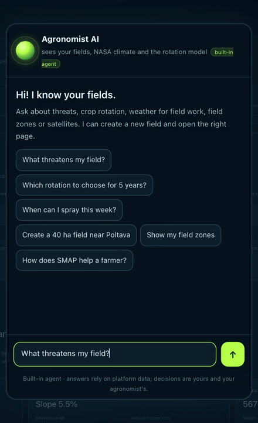</td>
  </tr>
</table>

<p align="center">
  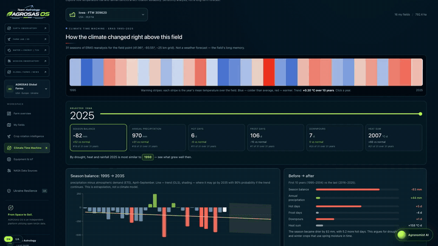
  <br><sub>Climate time machine — every season since 1995 above this exact field</sub>
</p>

### More inside

| | |
|---|---|
| ✅ **72-hour action plan** — frost warnings, spraying windows and inspections, each with a reason and a source; “Done as planned” closes a task in one click | 🕰️ **Climate time machine** — warming stripes, drought, heat and the trend to 2035 for this exact field from 30 seasons of ERA5 |
| 🚜 **Digital farm** — the farm at real scale: which satellites are overhead right now, and how much the panels and turbine will produce under the real forecast | 🚀 **NASA missions** — official 3D models, live orbits, NASA videos and a plain explanation of what each mission gives a farmer, plus fleet statistics |
| 📰 **NASA news for farmers** — a self-updating feed; every story tagged with its topic, why it matters for a field and which satellites took the image | 🇺🇦 **Ukraine resilience** — backup power status, civil-defence channels and a mine-safety checklist before field work |

---

## Screens

<p align="center">
  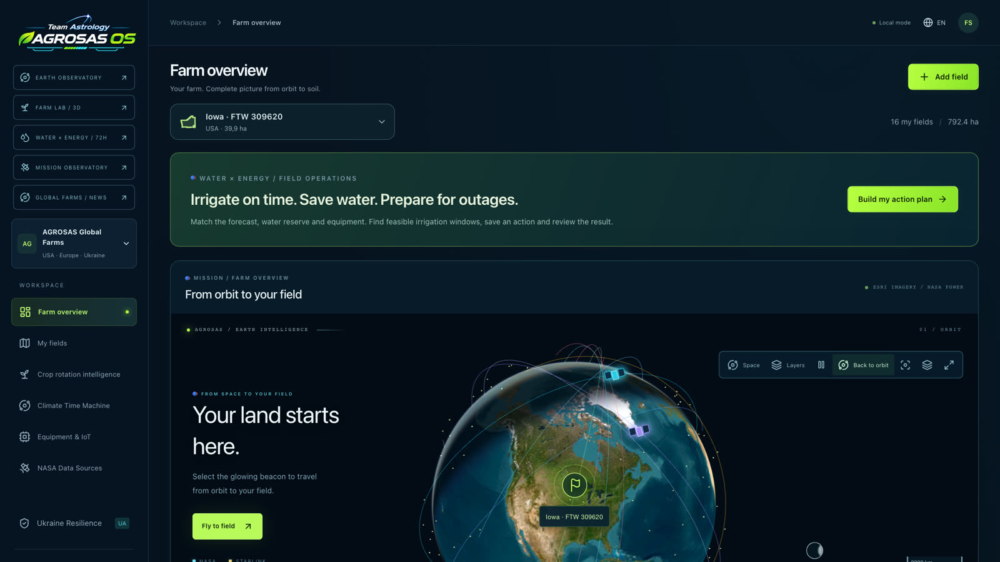
  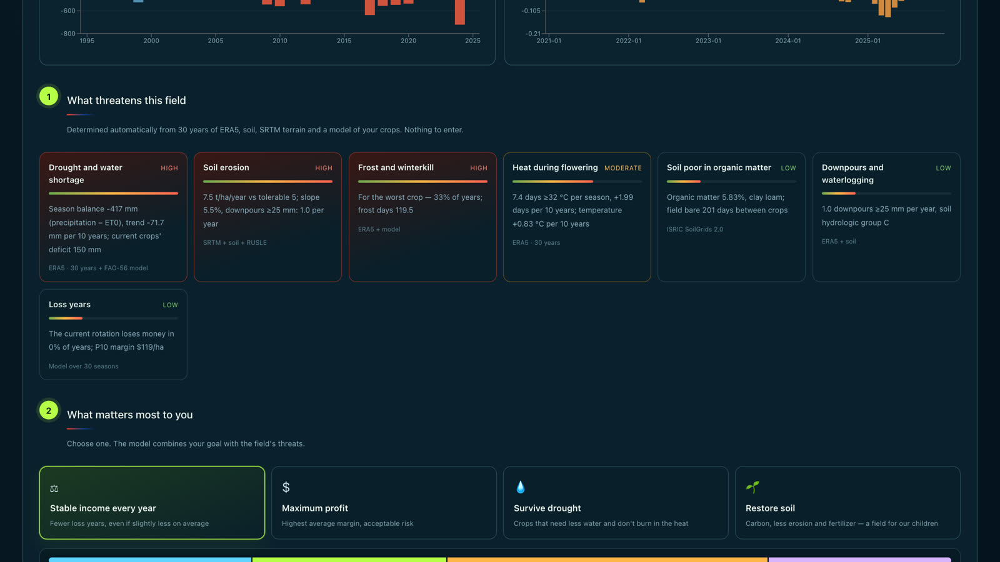
  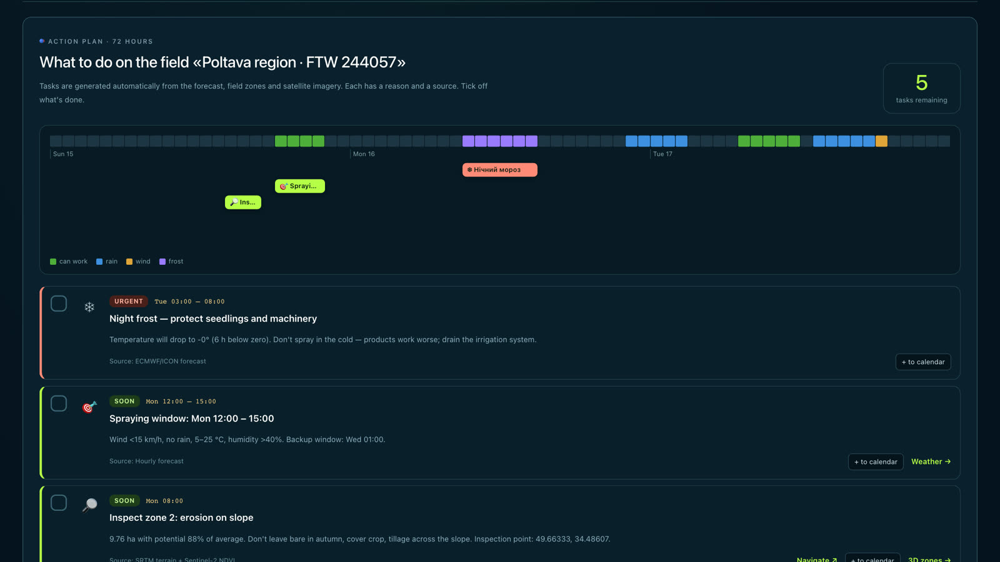
  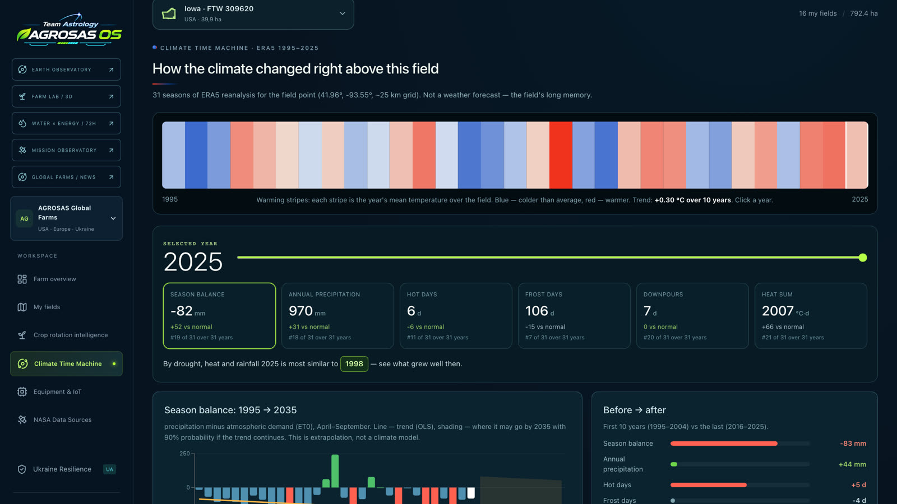
</p>
<p align="center">
  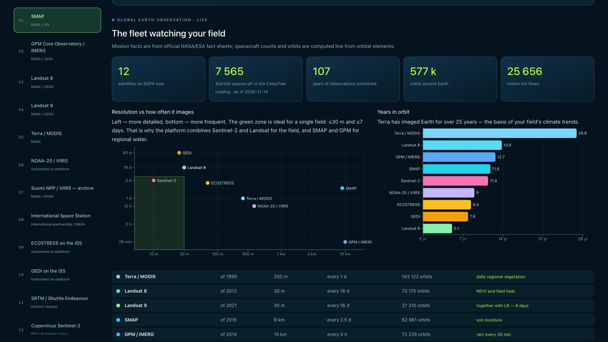
</p>

---

## Open data, honestly used

| Source | What AGROSAS uses it for |
|---|---|
| **NASA GIBS** — MODIS (Terra/Aqua), VIIRS | Daily regional vegetation and cloud context |
| **SMAP** | Soil moisture of the top 5 cm and root zone |
| **GPM IMERG** | Precipitation every 30 minutes |
| **Landsat 8/9**, **ECOSTRESS** | Field heat and water stress |
| **NASA POWER**, **Earthdata** | Agro-climate series and data discovery |
| **SRTM** | Terrain, slope, water flow and erosion |
| **Sentinel-2** (Copernicus) | 10 m NDVI, leaf water and chlorophyll by zone |
| **ERA5** (Copernicus) | 30 years of daily climate above each field |
| **SoilGrids** (ISRIC) | Soil texture and organic carbon |
| **CelesTrak / SatNOGS** | Orbital elements for live SGP4 propagation |
| **NASA JPL** | Planet and comet positions |

Every number carries its source, date and resolution. When a source is unavailable the platform says so — it never invents a measurement.

---

## Architecture

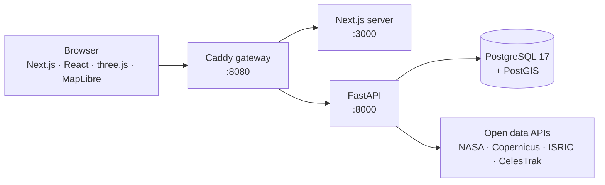

| Layer | Stack |
|---|---|
| **Frontend** | Next.js 16, React 19, TypeScript, Tailwind CSS 4, TanStack Query, three.js, MapLibre GL, Recharts, satellite.js |
| **Backend** | Python 3.12, FastAPI, Pydantic 2, SQLAlchemy 2, Alembic, HTTPX |
| **Data** | PostgreSQL 17 + PostGIS (field polygons in SRID 4326) |
| **Ops** | Docker Compose, Caddy, one-command operator script `./fieldshift` |
| **i18n** | Full English and Ukrainian UI, English by default |

---

## Quick start

Requires [Docker Desktop](https://docs.docker.com/desktop/).

```bash
git clone https://github.com/Storozh-007/AGROSAS-FieldShift.git
cd AGROSAS-FieldShift
./fieldshift start        # build, migrate, health-check
./fieldshift seed         # optional: demo farm with example fields
```

Open **http://localhost:8080** · API docs at **http://localhost:8080/api/docs**

| Command | |
|---|---|
| `./fieldshift stop` | stop, keep data |
| `./fieldshift update` | backup → rebuild → migrate → start |
| `./fieldshift backup` / `restore` | database snapshots |
| `./fieldshift doctor` | diagnose config, database, API and pages |
| `./fieldshift --mode dev start` | hot-reload development stack |

More: [DOCKER_SETUP.md](DOCKER_SETUP.md) · [OPERATIONS.md](OPERATIONS.md) · [DEPLOYMENT.md](DEPLOYMENT.md)

### Main routes

| Route | |
|---|---|
| `/dashboard` | Globe, satellites and your fields |
| `/farm-lab` | Rotation model, zones, action plan, digital farm, field from space |
| `/climate` | Climate time machine |
| `/missions` | NASA missions and fleet statistics |
| `/network` | Farms, profiles, events and NASA news |

---

## Tests

| Suite | Command | Count |
|---|---|---|
| Backend (pytest) | `./fieldshift test` | 52 |
| Frontend unit (Vitest) | `cd frontend && npm test` | 31 |
| Browser end-to-end (Playwright) | `cd frontend && npm run test:e2e` | 29 |
| Types | `cd frontend && npm run typecheck` | — |

---

## Repository

```
backend/    FastAPI app, rotation engine, data adapters, Alembic migrations, tests
frontend/   Next.js app: globe, farm lab, 3D scenes, i18n, Playwright and Vitest tests
demo/       Scripts that record the narrated tour, the 60 fps teaser and deck clips
docs/       Design notes, data-source notes and verification reports
scripts/    Backup, restore, ingestion and verification helpers
fieldshift  One-command operator for the Docker stack
```

---

## Team Astrology

| | |
|---|---|
| **Oleksandr Yaroslavskyi** | Developer |
| **Ivan Shvets** | Developer |
| **Danylo Storozhenko** | Developer |

Built for the **NASA Space Apps Challenge 2026 · Field Shift**, Dnipro.

## License

[MIT](LICENSE)
